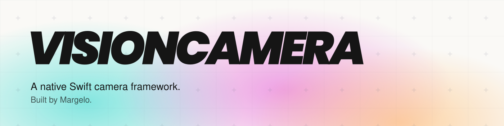

<a href="./Sources/VisionCamera/Documentation.docc/VisionCamera.md">
  <picture>
    <source media="(prefers-color-scheme: dark)" srcset="./images/banner-dark.svg" />
    <source media="(prefers-color-scheme: light)" srcset="./images/banner-light.svg" />
    
  </picture>
</a>

<br />

VisionCamera is a powerful, high-performance Camera framework for Swift, built on AVFoundation.
It brings the camera engine from [react-native-vision-camera](https://github.com/margelo/react-native-vision-camera) to native iOS apps, with Apple camera types and Swift APIs. It features:

* Photo capture, RAW photos, and Video recording with audio
* UIKit previews, smooth zooming, and tap-to-focus
* Customizable devices, multi-cameras, resolutions, and FPS
* Persistent recordings that keep going while you flip the Camera
* Frame and depth outputs for image processing, computer vision, and realtime video
* QR/Barcode and face detection through AVFoundation
* Video HDR, stabilization, and manual Camera controls

Requires iOS 15.1 or later. UIKit is supported today. Other Apple platforms and SwiftUI are planned.

### Installation

#### Swift Package Manager

VisionCamera requires Xcode 26 or later and supports iOS 15.1 or later. The package uses Swift 5 language mode and has no external dependencies.

1. In Xcode, choose **File > Add Package Dependencies**.
2. Enter `https://github.com/margelo/VisionCamera.git`.
3. Until the first release containing `Package.swift`, select the **Branch** dependency rule and enter `main`. The existing `0.1.0` tag does not include the package manifest.
4. Add the **VisionCamera** library product to your app target.

The repository is currently private. Authenticate with a GitHub account that has access. For SSH authentication, use `ssh://git@github.com/margelo/VisionCamera.git` with a configured GitHub SSH key.

For another Swift package, add the dependency and library product to your `Package.swift`:

```swift
dependencies: [
	.package(url: "https://github.com/margelo/VisionCamera.git", branch: "main")
],
targets: [
	.target(
		name: "YourApp",
		dependencies: [
			.product(name: "VisionCamera", package: "VisionCamera")
		]
	)
]
```

After the first SPM release, use a version requirement instead of `branch: "main"`. For a `0.1.1` release, use `.upToNextMinor(from: "0.1.1")` to receive compatible `0.1.x` updates. Use a released version containing `Package.swift` before publishing a package that depends on VisionCamera.

#### CocoaPods

Add VisionCamera to your `Podfile`:

```ruby
pod 'VisionCamera',
    :git => 'git@github.com:margelo/VisionCamera.git',
    :branch => 'main'
```

Run `pod install` and open your app's `.xcworkspace`.
The repository is private, so your GitHub account needs access.
These docs describe the current `main` branch. The `0.1.0` tag is the initial extraction and has an older API.
Pin a release tag once a release containing these changes is available.

..and get started by [setting up permissions](./Sources/VisionCamera/Documentation.docc/Guides/GettingStarted.md)!

### Example

Add `NSCameraUsageDescription` to your app's `Info.plist`, then connect a Camera to a preview:

```swift
import UIKit
import VisionCamera

@MainActor
func startCamera(in previewView: PreviewView) async throws -> CameraSession {
	guard try await VisionCamera.requestCameraPermission() else {
		throw PermissionError.cameraAccessDenied(status: VisionCamera.cameraPermissionStatus)
	}

	let preview = PreviewOutput()
	previewView.output = preview

	let session = CameraSession()
	_ = try await session.configure([
		CameraSessionConnection(
			input: .position(.back),
			outputs: [CameraOutputConfiguration(output: preview)],
			constraints: [.resolution(preview)]
		)
	])
	await session.start()
	return session
}
```

Keep the returned session alive, and call `await session.stop()` when the Camera is no longer active.
See the [UIKit example app](./Example/) for a full camera screen with permissions, lifecycle handling, photos, and both video recorders.

### Documentation

The [guides](./Sources/VisionCamera/Documentation.docc/VisionCamera.md) and API reference are written with DocC, Apple's documentation compiler.
You can read them in Xcode or build the documentation website locally. See [Building the documentation](./Documentation.md).

The [Apple API audit and migration notes](./APPLE_API_AUDIT.md) explain the compatibility APIs removed from the original extraction and their native replacements.

### Build and test

Open `Package.swift` in Xcode, select the **VisionCamera** scheme and an iOS simulator, then choose **Product > Test**.

To build for iOS from the command line:

```sh
xcodebuild -scheme VisionCamera -configuration Release \
	-destination 'generic/platform=iOS' \
	-derivedDataPath build/spm-device CODE_SIGNING_ALLOWED=NO build
```

To run the existing tests, replace `<simulator-udid>` with an available iOS simulator identifier from `xcrun simctl list devices available`:

```sh
xcodebuild -scheme VisionCamera \
	-destination 'platform=iOS Simulator,id=<simulator-udid>' \
	-derivedDataPath build/spm-simulator CODE_SIGNING_ALLOWED=NO test
```

The framework imports UIKit and requires an iOS destination. `swift test` on the macOS host cannot build it.

For release instructions, see [Publishing](PUBLISHING.md).

### Adopting at scale

VisionCamera is built by [Margelo](https://margelo.com).
We make apps better and faster.

### Links

* [Community Discord](https://margelo.com/discord)
* [Follow me on Twitter](https://twitter.com/mrousavy) for updates
* [Check out my blog](https://mrousavy.com/blog) for examples and experiments
* [MIT License](./LICENSE)
